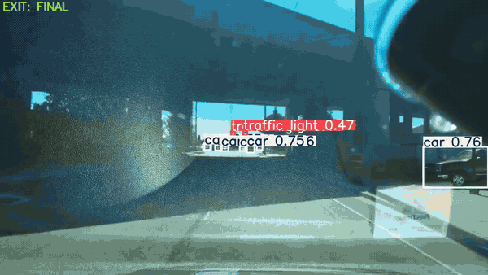
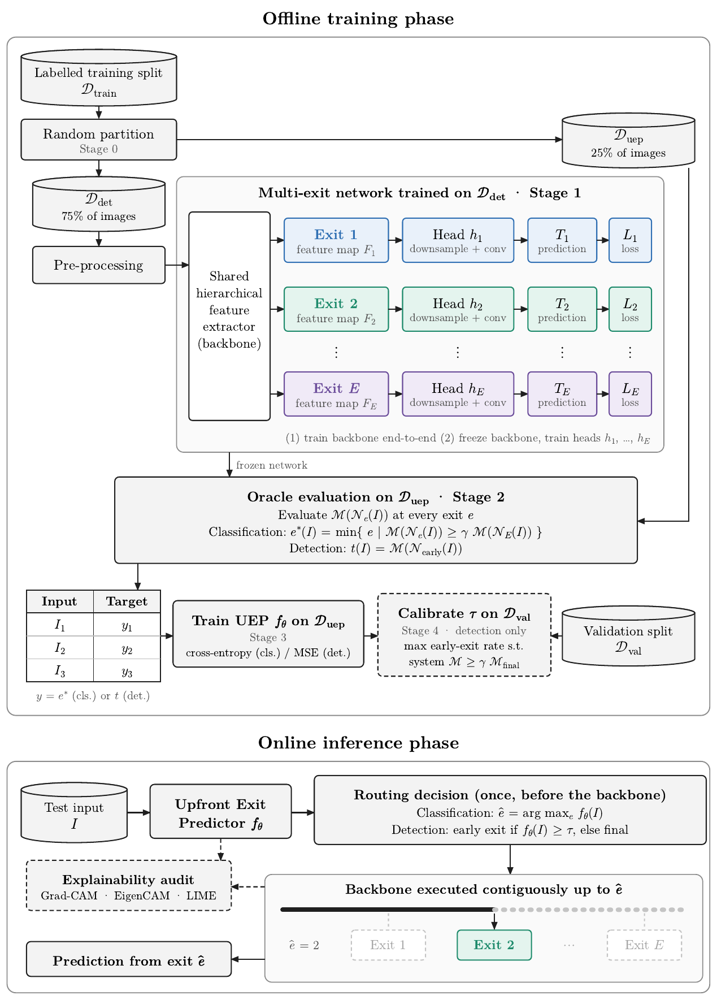
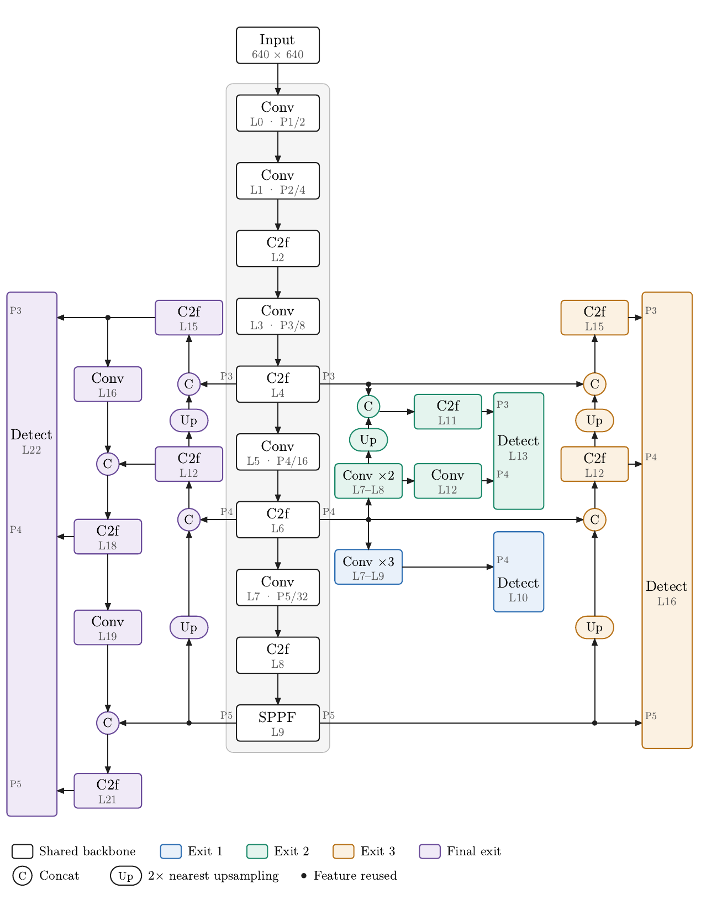
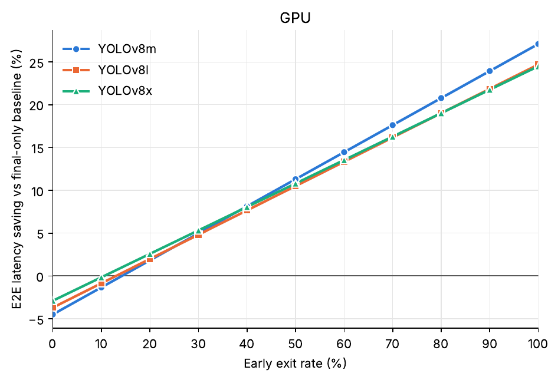
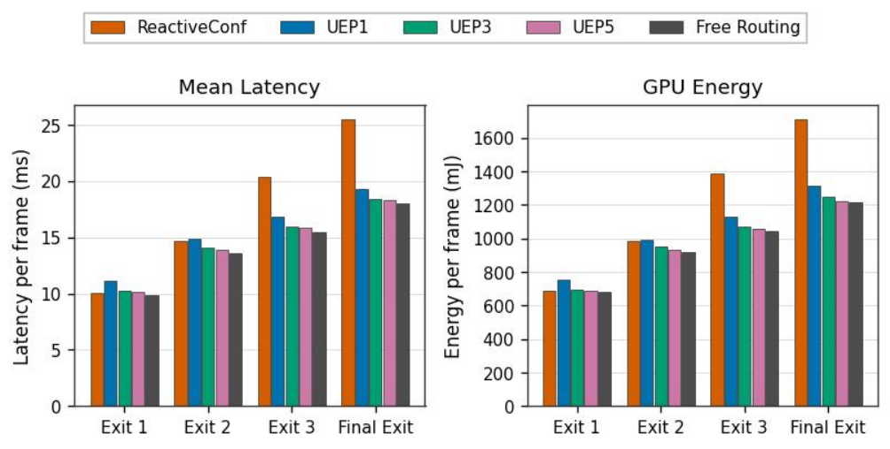
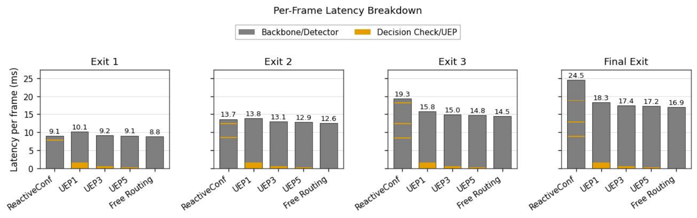
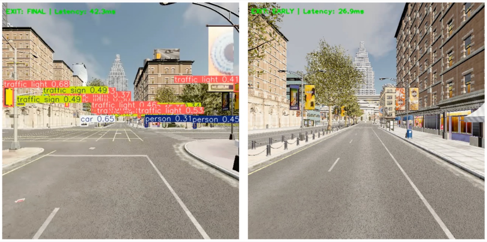

# UEPNet: An Upfront Exit Prediction Framework for Early-Exit Neural Networks in Intelligent Vehicles

**Ankitha A. Reddy, Saathvik B., Anusha Jayasimhan, Ganesh R. Naik**

A self-driving car has to detect objects around it like cars, pedestrians and traffic signs many times every second, on onboard hardware with limited compute and power. Most frames, like an empty highway, are easy, yet a standard detector spends the same heavy computation on every one of them. Running a lighter model on simple scenes and saving the full model for crowded or complex ones makes perception faster and more energy-efficient.

Early-exit neural networks do this by letting a frame stop at an intermediate layer when the answer is already good enough. But they decide *while* running: every intermediate exit head and confidence check has to be evaluated before the network can stop. UEPNet makes that decision **once, before the backbone runs**. A lightweight Upfront Exit Predictor (UEP) looks at the raw frame, predicts how deep the network needs to go, and only that contiguous part of the backbone is executed.

On autonomous-driving object detection with YOLOv8m on BDD100K, UEPNet cuts **end-to-end latency by 21.9%** while keeping **98% of the baseline model's performance**, with the predictor's cost included.

<p align="center">
  <a href="assets/demo.mp4"></a>
  <br><sub>Dense traffic and bad weather send more frames to the final exit, while open roads take the early exit to save compute. 2× speed; click for the full video.</sub>
</p>

## How it works

<p align="center"></p>

1. **Multi-exit backbone.** Exit heads are attached at intermediate depths of the backbone. The backbone and heads are trained on 75% of the training set.
2. **Oracle labels.** On the held-out 25%, every exit is evaluated per image to find the shallowest exit that is good enough. For detection, the label is the early exit's per-image F1-score.
3. **Upfront Exit Predictor.** A small network (MobileNetV3-Small for detection) learns to predict that label from the raw input.
4. **Inference.** The UEP runs once. If the predicted score clears a threshold τ, the frame takes the early exit; otherwise it takes the final exit. τ is tuned to a retention target γ (e.g. 98% of final-exit F1), so the accuracy–efficiency trade-off can be changed without retraining.

### Early exits in YOLOv8

<p align="center"></p>

All exits share the frozen backbone. Exit 2 on YOLOv8m, which branches at layer 6 and fuses P4 with P3 features, nearly matches standalone YOLOv8s accuracy (42.7% vs. 43.4% test mAP@0.5) without deploying a separate model.

## Results

**End-to-end latency** (YOLOv8m, BDD100K):

| | Latency per frame |
| :-- | :--: |
| Final exit only (baseline) | 17.5 ms |
| Early exit only | 12.0 ms |
| UEP alone | 0.75 ms |
| UEPNet at 98% F1 retention (UEP included in every frame) | **21.9% lower than baseline** |

The UEP needs only 0.12 GFLOPs, 0.2% of YOLOv8m's compute. Its cost is recovered as soon as about one frame in five takes the early exit, and larger detectors need even fewer early exits to break even.

<p align="center"></p>

**Versus reactive early exiting.** The comparison uses a four-exit YOLOv8x, the same exits and the same frames, and runs on an NVIDIA T4. For frames that need the full network, upfront routing cuts latency from **25.50 → 19.34 ms (−24.2%)** and GPU energy by **23.3%**. A reactive confidence-gated cascade's overhead grows with every exit it passes, from 0.20 to 7.52 ms. The UEP's overhead stays constant at about 1.3 ms. With frames split equally across exits, UEPNet lowers mean latency by **11.9%**.

<p align="center"></p>

The per-frame breakdown below splits latency into backbone/detector computation and the decision mechanism. Most of the reactive cascade's extra cost comes from the intermediate exit heads it must run before it can check confidence. At the Final Exit, running the UEP on every frame (UEP1) or every fifth frame (UEP5) comes within 1.4 ms and 0.3 ms of Free Routing, which takes the correct exit at no decision cost.

<p align="center"></p>

**CARLA simulation.** Dense intersections are routed to the final exit (42.3 ms), and open roads take the early exit (26.9 ms).

<p align="center"></p>

## Repository structure

| File | Description |
| :-- | :-- |
| `bdd100k_pipeline.ipynb` | Full BDD100K pipeline: 75/25 split, YOLOv8m and early-exit training, UEP targets, UEP regressor training (MobileNetV3-Small, EfficientNet-B0, ResNet18), threshold sweep and evaluation. |
| `kitti_pipeline.ipynb` | Same pipeline on KITTI. |
| `e2e_latency.ipynb` | End-to-end per-frame latency on GPU and CPU for YOLOv8m/l/x with the UEP, plus GFLOPs and break-even rates. |
| `uep_vs_reactive.ipynb` | Routing cost of the UEP vs. reactive confidence gating on a four-exit YOLOv8x: latency, GPU energy, decision overhead. |
| `classification.ipynb` | CIFAR-10 early-exit ResNet18, VGG16 and MobileNetV2 with UEP training. |
| `classification_metrics.ipynb` | Per-exit parameters, GFLOPs, latency, peak memory and GPU energy of the classification models. |
| `detection_training.ipynb` | Training of the YOLOv8 early- and final-exit models. |
| `explainability.ipynb` | Grad-CAM, EigenCAM and LIME for the early/final exits and the UEP. |
| `carla.ipynb` | UEP-routed detection in the CARLA simulator with annotated video output. |
| `deployment.py` | Gradio app that runs UEP-routed detection on an uploaded video. |
| `uep_legacy.ipynb`, `uep_regression_legacy.ipynb` | Earlier versions of UEP training and evaluation, superseded by the `*_pipeline` notebooks. |

## Getting started

```bash
pip install -r requirements.txt
```

The notebooks were run on Kaggle with NVIDIA T4 GPUs and expect the datasets as Kaggle inputs or local copies:
[BDD100K](https://bdd-data.berkeley.edu/) · [KITTI](https://www.cvlibs.net/datasets/kitti/) · [CIFAR-10](https://www.cs.toronto.edu/~kriz/cifar.html) · [CARLA](https://carla.org/)
